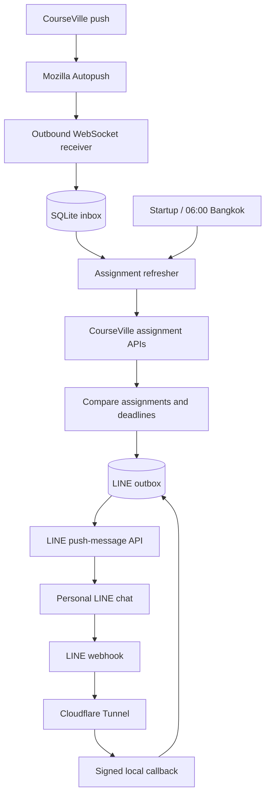

# mCV Notifier — reference manual

Reference for the personal Pi service, inspected on 4 October 2026. These Python modules are internal application APIs, not a published library with stable compatibility guarantees.

## Contents

- [Architecture](#architecture)
- [Files and directories](#files-and-directories)
- [Install and update](#install-and-update)
- [Everyday commands](#everyday-commands)
- [CLI reference](#cli-reference)
- [Configuration](#configuration)
- [Scheduling and delivery](#scheduling-and-delivery)
- [Database](#database)
- [Python API](#python-api)
- [Troubleshooting](#troubleshooting)
- [Testing and limitations](#testing-and-limitations)

## Architecture

One CourseVille account, one LINE recipient, two systemd services. No Docker, Firebase, admin dashboard or automated backups.



`mcv-noti.service` owns the receiver, database, scheduler, delivery and local HTTP server. Blocking HTTP calls run in worker threads; database operations stay on the event-loop thread. The main loop normally wakes every five seconds, although requests can delay a pass.

`mcv-tunnel.service` owns cloudflared. It discovers a new public URL, tests the callback through LINE, updates the channel endpoint if needed, reads it back, confirms webhooks are active, and tests again. It periodically reconciles the endpoint. The tunnel is for LINE callbacks, not CourseVille push.

A push means data may have changed. The receiver decrypts it, commits it to SQLite, then acknowledges it. The application subsequently fetches assignments and decides what to send. Push acknowledgement and LINE delivery are separate durable stages.

## Files and directories

| File | Responsibility |
| --- | --- |
| `receiver/autopush.py` | Push identity, encryption, connection, acknowledgement and reconnect |
| `receiver/store.py` | SQLite inbox/metadata, refresh counters, process lock |
| `receiver/courseville.py` | Account decryption, subscription registration, assignment API |
| `receiver/session.py` | Login form and alpha OAuth client discovery |
| `receiver/logging.py` | Allowlisted JSON diagnostics and bounded queue |
| `receiver/proof.py` | Live controlled-sender transport test |
| `receiver/__main__.py` | Receiver command-line tools |
| `mcv_service/__main__.py` | Application startup and scheduling/delivery loop |
| `mcv_service/engine.py` | Assignment changes, reminders and persistent outbox |
| `mcv_service/line.py` | LINE sending, chunking and retry keys |
| `mcv_service/webhook.py` | Signature checks and personal commands |
| `mcv_service/tunnel.py` | Cloudflare process and LINE endpoint management |
| `scripts/check-pi.sh` | Read-only platform checks |
| `scripts/setup-pi.sh` | Installation and activation |
| `scripts/import_account.py` | Import one encrypted account |
| `deploy/*.service` | systemd services, credentials and restart policies |
| `deploy/journald-mcv-noti.conf` | Log retention |
| `tests/` | Automated behaviour and recovery tests |
| `requirements.txt` | Pinned production dependencies |
| `requirements-test.txt` | Production plus tests/proof dependencies |
| `__init__.py` | Python package marker |

### Source versus installed service

| Path | Meaning |
| --- | --- |
| `~/mCV_noti` | Git checkout; editing it does not change the running installed code |
| `/opt/mcv-noti/releases/<digest>` | Installed release and its Python virtual environment |
| `/opt/mcv-noti/current` | Symlink to active release |
| `/var/lib/mcv-noti/main.db` | Pi account plus runtime state |
| `/var/lib/mcv-noti/ingress.json` | Tunnel readiness/generation diagnostic |
| `/var/lib/mcv-noti/tunnel-home` | Isolated cloudflared home |
| `/etc/mcv-noti/credentials/private_key.pem` | Account decryption key |
| `/etc/mcv-noti/credentials/line.env` | LINE channel credentials |
| `/etc/systemd/system/mcv-*.service` | Installed service definitions |

On Windows, `database/main.db` supplies the account and `state/main.db` stores runtime state. On the Pi those roles share one database. `database/log.db` is an unused legacy log. `.pyc`/`__pycache__` are disposable Python caches.

## Install and update

Requires 64-bit Linux (`aarch64`), Python 3.11+, systemd 247+, at least 1 GiB free under `/var`, working DNS/HTTPS and a synchronized clock. The installer uses APT and installs cloudflared if missing. Broken unrelated APT repositories can block installation.

```bash
git clone --branch cleanup/pi-service --single-branch https://github.com/Thanat-Music/mCV_noti.git
cd mCV_noti
bash scripts/setup-pi.sh --check
sudo bash scripts/setup-pi.sh --install
```

`--check` is read-only. `--install` stages code and installs stopped services. It preserves credentials/state and does not create backups. Transfer the existing account database, matching RSA key and LINE dotenv file privately to `~/mcv-transfer`, then:

```bash
chmod 700 ~/mcv-transfer
chmod 600 ~/mcv-transfer/main.db ~/mcv-transfer/private_key.pem ~/mcv-transfer/.env
sudo python3 scripts/import_account.py ~/mcv-transfer/main.db /var/lib/mcv-noti/main.db --user u1
sudo chown mcv-noti:mcv-noti /var/lib/mcv-noti/main.db
sudo chmod 600 /var/lib/mcv-noti/main.db
sudo install -m 600 ~/mcv-transfer/private_key.pem /etc/mcv-noti/credentials/private_key.pem
sudo install -m 600 ~/mcv-transfer/.env /etc/mcv-noti/credentials/line.env
sudo bash scripts/setup-pi.sh --activate
```

Activation checks account decryption and enables real delivery plus tunnel management now and at boot. Startup does not prove end-to-end readiness. Enable webhook use for the matching LINE channel and ensure the recipient is correct.

For updates:

```bash
cd ~/mCV_noti
git status --short
# Review any local Pi edits first; proceed with a clean checkout.
git pull --ff-only
sudo bash scripts/setup-pi.sh --install
sudo bash scripts/setup-pi.sh --activate
```

Do not discard Pi patches with a hard reset without reviewing them. A routine update does not need account re-import. Import refuses a differing account row, including a recipient corrected on the Pi. Old releases remain; no automated pruning/rollback exists. Restart alone uses the already installed release, not checkout edits.

## Everyday commands

```bash
# Service state and startup at boot
sudo systemctl status mcv-noti mcv-tunnel --no-pager -l
systemctl is-enabled mcv-noti mcv-tunnel

# Recent and live logs
sudo journalctl --namespace=mcv-noti -u mcv-noti -u mcv-tunnel -n 60 -f -o cat

# Future logs only; silence may mean no new events
sudo journalctl --namespace=mcv-noti -u mcv-noti -u mcv-tunnel -n 0 -f -o cat

# Local server availability, not upstream health
curl --max-time 5 -i http://127.0.0.1:8080/healthz

# Read-only receiver status; safe during operation
sudo -u mcv-noti /opt/mcv-noti/current/.venv/bin/python -m receiver --database /var/lib/mcv-noti/main.db status

# App restart also requests a fetch; tunnel restart may change its URL
sudo systemctl restart mcv-noti
sudo systemctl restart mcv-tunnel

# Stop both (still enabled at boot)
sudo systemctl stop mcv-tunnel mcv-noti

# Stop and disable at boot
sudo systemctl disable --now mcv-tunnel mcv-noti

# Start and enable at boot
sudo systemctl enable --now mcv-noti mcv-tunnel
```

Send `status` in the personal LINE chat for last successful refresh time. Other accepted text returns help. Responses use the outgoing push API, not reply tokens. Only the configured sender is accepted. Queued command responses expire after five minutes.

## CLI reference

Run development commands from the checkout with its virtual environment activated. Relative paths are relative to the current directory.

### Main application: `python -m mcv_service`

| Option | Default | Meaning |
| --- | --- | --- |
| `--database PATH` | `state/main.db` | Runtime SQLite database |
| `--legacy-database PATH` | `database/main.db` | Account database; may equal runtime DB |
| `--legacy-key PATH` | `secret/private_key.pem` | RSA private key |
| `--legacy-user ID` | `u1` | Selected account |
| `--line-env PATH` | `.env` | LINE dotenv file |
| `--send` | Off | Enable real LINE delivery |
| `--webhook` | Off | Enable HTTP listener on loopback |
| `--port N` | `8080` | HTTP port; tunnel currently targets 8080 |
| `--no-receiver` | Off | Disable Autopush for this process |
| `--once` | Off | One processing pass; failed refresh exits nonzero |
| `--seconds N` | `0` | Request shutdown after N seconds; 0 = indefinite |

```bash
python -m mcv_service --help
python -m mcv_service --database state/dry-run.db --once --no-receiver
python -m mcv_service --database state/manual.db --send --webhook
```

Dry-run prevents LINE sending, but still writes state/queues messages. Without `--no-receiver`, it can register/publish a subscription. Use a disposable DB and do not later activate its test outbox in production. `--once` does not guarantee registration completes before exit. Do not run a second production receiver against a database already owned by systemd.

### Receiver: `python -m receiver`

Global `--database PATH` precedes the command. Default is `MCV_DATABASE` environment variable or `state/main.db`. That variable does not configure the main application.

| Command | Effect |
| --- | --- |
| `status` | Read-only sanitized stored status; does not test connectivity |
| `register` | Create/reuse Autopush identity and subscription |
| `publish` | Publish existing subscription to CourseVille |
| `verify` | Check CourseVille subscription list/check agreement |
| `listen [--seconds N]` | Persist received push; no assignment engine or LINE sending |
| `proof` | Temporary controlled-sender test; requires test dependencies |

`publish` and `verify` accept `--legacy-user`, `--legacy-database`, `--legacy-key`. Without `--legacy-user`, hidden prompts ask for credentials.

```bash
# Isolated diagnostics; registration/publishing changes external state.
python -m receiver --database state/diagnostic.db register
python -m receiver --database state/diagnostic.db publish --legacy-user u1
python -m receiver --database state/diagnostic.db verify --legacy-user u1
python -m receiver --database state/diagnostic.db listen --seconds 60
python -m receiver --database state/diagnostic.db status
python -m receiver proof
```

The main service manages registration automatically. Avoid creating repeated diagnostic subscriptions without managing their lifecycle. The `proof` command cleans up its temporary test channel.

### Tunnel: `python -m mcv_service.tunnel`

| Option | Default | Meaning |
| --- | --- | --- |
| `--line-env PATH` | Required | Channel token file |
| `--status PATH` | `state/ingress.json` | Readiness file and process lock |
| `--cloudflared PATH` | `cloudflared` | Executable |

Requires local app on port 8080. Use systemd on the Pi; competing managers can overwrite the same LINE channel endpoint.

### Account import

```bash
python scripts/import_account.py SOURCE_DB DESTINATION_DB --user u1
```

Reads source without modifying it, copies one account and preserves runtime tables. Identical import is idempotent. Differing existing account raises instead of overwriting.

## Configuration

Reminder thresholds/time are code constants, not a general settings file. Supported inputs are CLI options, account database and dotenv file.

```dotenv
CHANNEL_ACCESS_TOKEN=your_channel_access_token
CHANNEL_SECRET=your_channel_secret
```

The program reads the selected file using `dotenv_values`; exported shell variables do not substitute missing entries automatically.

| Account field | Expected format |
| --- | --- |
| `user_id` | `u1` by default |
| `cname` | Base64 RSA-OAEP/SHA-256 encrypted CourseVille username |
| `cpass` | Base64 RSA-OAEP/SHA-256 encrypted CourseVille password |
| `Line_uid` | Plaintext LINE user ID, typically U + 32 hexadecimal characters |

SQLite itself is not encrypted. Runtime contains sensitive push identity/key material and assignment data. Services run as `mcv-noti` with restricted directories; systemd passes RSA/LINE files using `LoadCredential`.

### Correct recipient

The original test account was found to have an encrypted password in `Line_uid`. This is incorrect data, not a requirement to decrypt recipient IDs. Update only the recipient using the correct ID for the channel:

```bash
sudo /opt/mcv-noti/current/.venv/bin/python -c '
import getpass, re, sqlite3
uid = getpass.getpass("LINE user ID (hidden): ").strip()
if not re.fullmatch(r"U[0-9a-fA-F]{32}", uid):
    raise SystemExit("Invalid user ID; nothing changed")
db = sqlite3.connect("/var/lib/mcv-noti/main.db", timeout=10)
with db:
    result = db.execute("UPDATE user SET Line_uid=? WHERE user_id=?", (uid, "u1"))
    if result.rowcount != 1:
        raise RuntimeError("u1 not found")
db.close()
print("Recipient updated")
'
sudo systemctl restart mcv-noti
```

Keep the source account consistent before future imports. Temporary UID logging used during deployment should be removed after pairing. Normal diagnostics omit credentials, user IDs and message bodies.

## Scheduling and delivery

### Refresh

Startup, committed push, a changed/unpublished subscription, and the daily Bangkok 06:00 pass request assignment refresh. Push counters coalesce work and preserve demand arriving during a fetch. Successful fetches have a ten-second minimum gap; failures retry from 120 seconds with exponential backoff capped at one hour.

Semester selection is a heuristic: August–December = semester 1/current year; January–May = semester 2/previous year; June–July = semester 3/previous year. No academic-calendar configuration exists yet.

### Assignment rules

`ASSIGNED` is eligible/unsubmitted. Other statuses are ineligible. A known deadline at/before now always stops reminders even if cached status remains unsubmitted.

| Event | Behaviour |
| --- | --- |
| First successful fetch | One initial summary, no separate historical alerts |
| New eligible assignment | Immediate queued alert |
| Deadline change | Increment generation, cancel old reminders, alert if eligible |
| No deadline | Informational alert/summary; no timed reminders |
| Deadline added | New generation and future thresholds |
| Submission/removal | Cancel pending applicable reminders when discovered |
| Title-only/material/announcement changes | No dedicated alert; a push may trigger assignment reconciliation |

Thresholds are deadline minus three days and minus one day, once each per deadline generation. Only future thresholds are created at discovery.

At/after 06:00 Bangkok, at most one deadline-summary row is created for the day. In continuous operation it selects thresholds reached by that morning's pass. Thresholds reached later normally wait until next morning, provided the assignment has not expired. This is a daily summary, not an exact 72-hour/24-hour alarm. Empty summaries are cancelled.

After downtime, the current day's pass skips thresholds older than yesterday's 06:00. Previous daily summaries are not replayed. The current summary expires at next Bangkok midnight. New/deadline-change alerts are not held until morning.

### LINE outbox

Before sending, recheck activity, deadline generation, status and deadline. Remove obsolete references or cancel the message. Equivalent retries retain frozen content and retry key; changed content gets a new key. Split text into 2,000-character chunks, up to five per request, using stable derived retry keys per batch.

HTTP 200 or 409 with an accepted-request header counts as accepted. Other 4xx except 429 marks the row permanently `failed`. Other errors remain `pending`, retrying from 60 seconds up to one hour. Failed rows do not restart automatically when credentials are repaired. There is no requeue CLI; use a fresh `status` command to verify repaired delivery.

Partial multi-batch sends and ambiguous failures can still duplicate messages. There is no exactly-once delivery guarantee.

## Database

SQLite uses WAL and `synchronous=FULL`. An adjacent lock excludes another receiver. A lock file existing does not mean it is held; never delete an active process's lock.

| Table | Purpose |
| --- | --- |
| `user` | Selected encrypted account and plaintext recipient |
| `push_state` | JSON subscription identity, metadata and scheduler markers |
| `push_inbox` | Unique `(channel,version)`, payload, receipt time/state |
| `push_refresh` | Singleton requested/completed generation counters |
| `app_items` | Assignment JSON, deadline generation and active flag |
| `app_reminders` | Unique `(item,generation,days)`, threshold and state |
| `app_outbox` | Message ID, unique dedupe key, refs/text, retry key, attempts/expiry |
| `app_line_events` | LINE event IDs for incoming deduplication |

Inbox states: pending, processed, quarantined. Reminder states: pending, queued, sent, cancelled, skipped. Outbox states: pending, sent, failed, cancelled, expired.

Tables are created if missing; there is no versioned migration framework. Deleting runtime state loses subscription identity and reminder history, not just replaceable assignment data.

Read-only queue counts without printing private contents:

```bash
sudo python3 - <<'PY'
import sqlite3
connection = sqlite3.connect("file:/var/lib/mcv-noti/main.db?mode=ro", uri=True)
try:
    for row in connection.execute("SELECT kind,state,COUNT(*) FROM app_outbox GROUP BY kind,state"):
        print(row)
finally:
    connection.close()
PY
```

Approximately daily retention removes processed inbox rows older than seven days and sent/cancelled/expired outbox rows older than 30 days. Pending, failed and quarantined records stay. Assignment/reminder history and LINE event IDs have no pruning yet. SQLite files need not shrink after deletes. Monitor disk usage; no automatic backups exist.

## Python API

These APIs can write state or contact external services. Run from the repository's Python environment. Times passed to the engine are Unix seconds.

### `receiver.store`

| API | Contract |
| --- | --- |
| `Store(path)` | Open/create SQLite state; caller must close |
| `get(name, default=None)` | Read JSON metadata |
| `put(name, value)` | Write/commit metadata; do not nest in larger engine transaction |
| `accept(channel,version,payload,state="pending")` | Atomically save event and increment refresh demand; bool indicates new event |
| `counts()` | Inbox counts by state |
| `Store.status(path)` | Read-only sanitized registration/timestamps, not connectivity proof |
| `close()` | Close connection |
| `ReceiverLock(path)` | Context manager for single-receiver ownership |

### `receiver.autopush`

| API | Contract |
| --- | --- |
| `Receiver(store,vapid=MCV_VAPID,url=MOZILLA_URL)` | Load/create persistent receiver with expected sender key |
| `await open()` / `await close()` | Connect/register or close transport |
| `await listen(stop)` | Reconnecting loop until asyncio Event is set |
| `await handle(message,acknowledge=True)` | Decrypt and persist before acknowledgement |
| `subscription(identity)` | Build registration dict containing sensitive endpoint/key material |
| `decrypt(identity,message)` | Decrypt supported Web Push payload |

Invalid payloads are quarantined and request reconciliation. Unknown channels are rejected. Commit-before-ack allows replay after interrupted acknowledgement without duplicate refresh demand for the same transport ID.

### `receiver.courseville` / `receiver.session`

| API | Contract |
| --- | --- |
| `legacy_account(database,key_path,user_id)` | Read/decrypt username/password; do not log return values |
| `login(username,password)` | Form login plus authenticated verification; returns CourseVille client |
| `CourseVille.call(name,payload=None)` | Web Push AJAX GET without payload or POST with JSON |
| `verify(subscription)` | Boolean requiring list/check agreement |
| `publish(subscription)` | Register with CourseVille and verify; external mutation |
| `assignments(now=None)` | OAuth discovery and current-semester assignment list; rejects API errors/invalid result shape |
| `LoginSession` | Login form/session helper |
| `discover_client_id(session)` | Discover current alpha OAuth client from script bundle |

### `mcv_service.engine`

| API | Contract |
| --- | --- |
| `due_timestamp(value)` | ISO date to Unix seconds; missing -> None, absent timezone -> error |
| `normalize(courses)` | Flatten/validate assignments keyed by `courseID:id` |
| `Engine(store)` | Create engine tables on same SQLite connection |
| `snapshot(courses,now,refresh_generation=0)` | Transactionally reconcile data, generations and alerts |
| `morning(now)` | Queue the day's summary subject to Bangkok 06:00 gate |
| `pending(now)` | Up to 20 due outbox rows ordered by creation |
| `prepare(row,now)` | Revalidate/freeze message; return `(id,text,retry_key)` or None |
| `accepted(id)` | Mark accepted outgoing message and included thresholds sent |
| `failed(id,now,permanent=False)` | Persist retry delay or permanent failed state |
| `incident(active,now)` | Queue refresh incident/recovery state transition |
| `retention(now)` | Remove eligible old operational records |

`_queue` and `_meta` are internal transaction helpers. A complete isolated example, without networking or LINE delivery:

```python
import time
from datetime import datetime, timezone
from tempfile import TemporaryDirectory
from pathlib import Path
from receiver.store import Store
from mcv_service.engine import Engine

with TemporaryDirectory() as directory:
    store = Store(Path(directory) / "example.db")
    try:
        engine = Engine(store)
        now = time.time()
        deadline = datetime.fromtimestamp(now + 5 * 86400, timezone.utc).isoformat()
        engine.snapshot([{
            "courseID": "demo", "title": "Demo course",
            "assignments": [{"id": "hw1", "title": "Homework 1",
                             "status": "ASSIGNED", "dueDate": deadline}],
        }], now)
        for row in engine.pending(now):
            prepared = engine.prepare(row, now)
            if prepared:
                print(prepared[1])  # Demo text; no actual delivery.
    finally:
        store.close()
```

### LINE, HTTP and tunnel

`Line(token,recipient,session=None).send(text,retry_key)` sends real messages; `retry_key` must be a UUID string. `DeliveryError` exposes `status` and `permanent` without remote response bodies.

`application(engine,secret,recipient)` builds an aiohttp application:

| Route | Result |
| --- | --- |
| `GET /healthz` | HTTP 200 with `{"ready":true}`; handler availability only |
| `POST /callback` | Raw-body HMAC-SHA256 verification, matching sender processing; HTTP 200 OK |

Invalid signature/JSON returns HTTP 400. Empty event lists are accepted for LINE verification. Body size is limited to 64 KiB. No public account-registration/admin routes exist.

`tunnel.candidate(line)` extracts a validated Quick Tunnel URL. `await reconcile(session,endpoint,alive)` tests, updates, reads back and retests the channel endpoint, with current-process checks. The readiness JSON cannot prove that a user message reached the bot.

## Troubleshooting

JSON logs contain UTC time, event and level, plus allowlisted metadata: attempt, delay_s, count, duration_ms, error_type, status, phase. Scheduling and user-facing deadlines use Bangkok time. 23:00 UTC is 06:00 Bangkok the next day.

The bounded 1,024-record queue drops diagnostics if saturated rather than blocking notification processing. Journal limits are 100 MB, 14 days, and a 1 GB free-space reserve. These limits do not bound database growth.

| Event or symptom | Meaning / action |
| --- | --- |
| `receiver.connected` | Transport connected; real CourseVille push still unproven |
| `courseville.subscription_verified` | CourseVille recognizes current subscription |
| `refresh.completed` | Assignment fetch succeeded; count is number of assignments |
| `delivery.accepted` | LINE API accepted request, not a read receipt |
| `delivery.failed` | Inspect HTTP status; permanent failures need attention |
| `webhook.received` | Valid signed JSON; count 0 may be LINE verification |
| `webhook.recipient_mismatch` | Sender differs from configured plaintext recipient |
| `line.ingress_ready` | Endpoint reconciliation passed, not outgoing delivery proof |
| `tunnel.failed` at startup | Local HTTP listener may not be ready; inspect eventual retry outcome |
| Persistent `line.webhook_retry` | Endpoint test/update incomplete; inspect channel and network |
| Silence with `-n 0 -f` | No new logs; inspect previous entries and services |
| `receiver_already_running` | Another process owns state; do not delete the live lock |
| `systemd: command not found` | Old preflight; current source uses systemctl --version |
| APT 404/key errors | Existing repository blocks installation; fix source/key, do not bypass signature checks |

### No reply to status

1. Check services and local `/healthz`.
2. Confirm `line.ingress_ready` after the latest tunnel restart.
3. Send a fresh `status` to the matching channel bot and watch new logs.
4. Recipient mismatch: correct `Line_uid`; it is not an encrypted field.
5. Delivery failure: inspect HTTP status and LINE configuration. A prior permanently failed row does not restart by itself.
6. No received event: check correct bot/channel and webhook configuration. A previous readiness event does not locate a later failure.

Successful status reply confirms incoming LINE/tunnel, matching recipient and outgoing LINE together. It does not prove CourseVille sender compatibility or scheduled reminders.

### Failed CourseVille refresh

Cached reminders can still run, labelled with last successful update when generated during failure. Recognized login errors or 24 hours without successful refresh during failure queue an incident. Recovery queues a recovery message. These alerts also require LINE to work. Refresh retries do not replay already accepted thresholds.

### Log privacy

Never print passwords, tokens, private keys, raw payloads or push endpoints. Temporary UID print statements used for initial pairing are not part of normal diagnostics. Logs deliberately omit user IDs and message contents. Do not expose the SQLite database or credential files as troubleshooting attachments.

## Testing and limitations

```bash
python -m pip install -r requirements-test.txt
python -m pytest tests -q
bash -n scripts/check-pi.sh
bash -n scripts/setup-pi.sh
python -m receiver proof
```

Production installation contains only runtime requirements; run proof in a development environment with test dependencies. The 36 automated tests cover durable acknowledgement, encryption, deduplication, locks, account import, reminders, delivery handling, webhook privacy/signature checks, OAuth discovery and tunnel reconciliation.

The live proof uses its own temporary sender/channel. It tests online receipt, wrong-sender rejection, duplicate suppression, offline delivery, subscription reuse and replay after an omitted acknowledgement. It does not prove CourseVille-originated delivery.

As of 4 October 2026: controlled transport proof passed; CourseVille registration and a 32-assignment fetch succeeded; the user deployed on Pi and confirmed a LINE status reply after fixing the recipient. Genuine CourseVille push, actual scheduled reminders and a prolonged outage/reboot soak remain acceptance checks.

Known limits: one account/recipient; experimental external Autopush protocol; heuristic semester calendar; no dashboard/backups; no requeue CLI; no general settings or versioned migrations; some histories have no pruning. Receiver identity loss may lose queued pushes. Startup/daily reconciliation recovers current assignments, not every historical notification.
